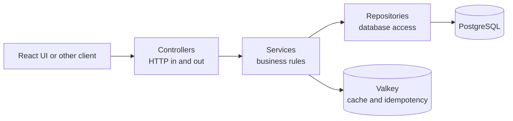

# E-Commerce Application

This workspace contains a small but complete e-commerce application, built to satisfy the requirements in
"Code Challenge e-commerce" (see `Code Challenge..pdf`). It covers product management (CRUD), bulk product import from
CSV, product search, a purchase flow with a fake payment, and a web interface for all of it. Everything runs locally
in Docker.

## Folder overview

| Folder              | What it is                                                                                                                                                                                                                          |
| ------------------- | ----------------------------------------------------------------------------------------------------------------------------------------------------------------------------------------------------------------------------------- |
| `ecommerce-api/`    | Backend microservice written in Java 25 and Spring Boot 4. It exposes the REST endpoints for products, categories and CSV import, stores data in PostgreSQL and uses Valkey (a Redis-compatible store) for caching and idempotency. |
| `ecommerce-ui/`     | Single-page web application written in React and TypeScript. It consumes the API to show the product catalog, search, manage products and complete a purchase.                                                                      |
| `ecommerce-docker/` | Docker Compose setup that starts the whole stack locally: PostgreSQL, Valkey, the API and the UI. It builds the API and UI images and runs them together.                                                                           |

Each folder has its own README with more detail. This file explains the overall design and how to start everything.

---

## ecommerce-api

### What it does

The API is the single place where business rules live. The UI never talks to the database directly. It sends
HTTP requests to the API, and the API decides whether they are valid, stores the data, and returns the result.

It provides:

- **Products:** create, read, update, and delete (delete is a soft delete, so the record is kept but hidden).
- **Categories:** a list of product categories. The database starts with 18 of them, and the API can also create,
  rename and delete them. A category that still has products cannot be deleted.
- **Search:** filter products by name, SKU, category, price range, minimum stock and weight range. Results are paged
  and can be sorted by creation date, price or name.
- **CSV import:** upload a file with products and create or update them in bulk. Invalid rows are skipped and reported
  back, so one bad line does not block the rest of the file.

### How it is organized

The code follows a layered structure, where each layer has one job:



- **Controllers** receive HTTP requests, validate the input, and return responses. They contain no business logic.
- **Services** hold the rules: a SKU must be unique, a SKU cannot be changed after creation, a product must be active to
  be updated, and so on. The services are split into _query_ (reads, search), _catalog_ (writes to a single product)
  and _import_ (CSV) responsibilities, so each one stays small and easy to test.
- **Repositories** talk to the database. Normal reads and writes use Spring Data JPA. The CSV import uses plain JDBC
  batch statements, because they are much faster when inserting or updating thousands of rows.
- **DTOs** (request and response objects) are separate from the database entities. The API never exposes the internal
  database model directly, which means the database can change without breaking clients.
- **Errors** are handled in one place and returned in a single, consistent JSON format, so the UI and other clients
  can show useful messages.

### Main decisions and why

- **PostgreSQL as the main database.** Products have strict rules (unique SKU, positive price, non-negative stock).
  A relational database enforces these rules in the database itself, not only in the code. PostgreSQL also has good
  support for search (trigram indexes make `LIKE '%text%'` searches fast) and for numeric money-style values.
- **Liquibase for schema changes.** The database structure is versioned in code. Every environment gets the same
  tables, and changes are applied in order. Hibernate does not create or change tables automatically.
- **Soft delete.** Deleting a product only marks it as inactive. This keeps history and avoids breaking future
  records (for example, purchase orders) that might reference the product.
- **Valkey for cache and idempotency.** Product detail and search results are cached, which reduces database load.
  The same store is used to protect `POST` requests with an `Idempotency-Key`: if the client retries a request
  (for example after a network failure), the API returns the original result instead of creating a duplicate.
- **Fail-open cache.** If Valkey is down, reads fall back to PostgreSQL and the application keeps working. The cache
  is a speed optimization, not a requirement for correctness.
- **Optimistic concurrency with ETags.** Each product has a version number that is sent as an `ETag`. An update can
  send `If-Match` with that version. If someone else changed the product in the meantime, the API returns `409 Conflict`
  instead of silently overwriting their changes.
- **HTTP caching headers.** Product details and search pages include `Cache-Control` and `ETag` headers, so browsers can
  reuse responses and skip downloads when nothing changed.
- **Batch CSV import with streaming.** The file is read line by line and written in batches of 1000 rows, with a limited
  number of batches running in parallel. This keeps memory usage low even for large files. Rows are upserted by SKU:
  a new SKU creates a product, an existing SKU updates it.
- **Virtual threads and Java records.** Virtual threads (enabled in Spring) handle many simultaneous requests cheaply.
  Java records are used for DTOs, which keeps them short and immutable.
- **Docker image built in two stages.** The first stage compiles the code with the full JDK. The second stage contains
  only a small runtime built with `jlink`, which makes the final image smaller and more secure.

### Pros

- Clear separation of concerns, which makes the code easier to read, change and test.
- Business rules are protected by both code checks and database constraints.
- Predictable, consistent error responses.
- Safe retries for create operations and safe concurrent edits for updates.
- The API keeps working when the cache is unavailable.
- Good test coverage with unit tests, slice tests, and integration tests that use real PostgreSQL and Valkey containers.

### Alternatives considered

- **A NoSQL database such as MongoDB.** This would fit a flexible product catalog with varying attributes. For this
  scope, the fixed product structure and the need for strict uniqueness and numeric rules favor PostgreSQL.
- **Hibernate schema generation instead of Liquibase.** Faster to start, but it hides schema changes and makes
  production upgrades risky. Versioned migrations are the safer choice for a shared environment.
- **Hard delete instead of soft delete.** Simpler, but it loses history and makes it harder to support orders or audits
  later.
- **Storing the cart on the server.** The current design keeps the cart in the browser. A server-side cart would let
  the cart follow a user across devices, but it requires user accounts, which were out of scope.
- **Event-driven import with a message queue (for example Kafka or RabbitMQ).** This would scale further and let the
  import run in the background. For the expected file sizes, a synchronous import with batching is simpler and
  easier to operate.
- **Authentication and roles.** The current API is open. A production version should add authentication (for example
  OAuth2 or JWT) and separate roles for administrators and customers.

### Known gaps and next steps

- The purchase endpoint is not implemented. The database already has `purchase_orders` and `purchase_order_items`
  tables, so a `POST /orders` endpoint could create orders and decrease stock in one transaction.
- Stock is not reduced by a server-side order yet. The UI checks stock locally, but the API is the one that should
  enforce it.
- Authentication and authorization are not included.

---

## ecommerce-ui

### What it does

The UI is a single-page application (SPA). The whole application runs in the browser: switching between screens does
not reload the page. It gives the user:

- **A product catalog** with a table, paging, sorting and filters (name, category, price, stock, weight).
- **A search bar** in the header to find products by name.
- **Product management:** create, view, edit and delete products, and import products from a CSV file. Import results
  show how many rows were inserted, updated or rejected, and why.
- **A shopping cart** in a side drawer. Users add products, change quantities (never above available stock), remove
  items, and clear the cart. The cart is saved in the browser, so it survives a page reload.
- **A checkout** that simulates the payment. It clears the cart and shows a confirmation message, as the challenge
  asks ("fake the payment").

### How it is organized

The code is organized by feature rather than by file type. Everything related to products lives in
`src/features/product`, everything related to the cart lives in `src/features/cart`, and so on:

```text
src/
  app/          layout, theme, and global providers
  core/         shared HTTP client setup
  features/
    product/    api, hooks, components, stores, types, utils
    category/   category list and lookup
    cart/       cart store, cart drawer, checkout
  shared/       small reusable pieces (loader, price formatting)
  mocks/        mock API used by tests
```

Inside a feature, the layers are split in the same way as in the API:

- **api** calls the backend with Axios.
- **hooks** wrap those calls with TanStack Query, which handles loading states, caching and retries.
- **stores** hold client-only state with Zustand (cart contents, filter values, paging).
- **components** are the visual pieces (tables, dialogs, forms).
- **model** contains the form validation rules, written with Zod.

### Main decisions and why

- **React with TypeScript.** React is widely used and has a large ecosystem. TypeScript catches many mistakes early,
  especially when the shape of the API data changes.
- **TanStack Query for server data.** Data that comes from the API is handled by a library built for that purpose.
  It caches results, avoids duplicate requests, refreshes lists after a change, and handles loading and error states.
  This avoids hand-written `useEffect` chains.
- **Zustand for local state.** The cart and the search filters are client-side state. Zustand is small, has little
  boilerplate, and the cart can be saved to `localStorage` with a single middleware.
- **Material UI for components.** Tables, dialogs, drawers and form fields are ready-made and accessible, which saves
  time and keeps the look consistent.
- **Zod and React Hook Form for forms.** The same validation rules (SKU format, price with two decimals, stock as a whole
  number) run in the browser before the request is sent. Server errors are shown next to the matching field.
- **Idempotency keys in the browser.** Each new product gets a UUID that is reused if the user presses save twice,
  so a double click does not create two products.
- **Money in cents.** The cart calculates totals in cents internally to avoid floating-point rounding errors.
- **Build-time API URL.** The API address is baked into the bundle when the image is built (`VITE_API_BASE_URL`). This
  keeps the runtime image simple: it is only static files served by nginx.
- **nginx to serve the app.** nginx serves the built files and falls back to `index.html` for any route, which is
  what a SPA needs.
- **Tests with Vitest, Testing Library and MSW.** Components are tested the way users use them, and the API is mocked
  with MSW, so tests do not need a running backend.

### Pros

- Clear feature folders: a developer working on the cart does not need to touch product code.
- Little custom state code, because the data-fetching and form libraries handle the hard parts.
- Validation happens early in the browser and again in the API, so users get fast feedback.
- The cart survives a page reload and cannot exceed available stock.
- The build output is static files, so the production image is small and easy to host anywhere.

### Alternatives considered

- **Next.js or another server-side framework.** These offer server rendering and SEO benefits. For a catalog that
  needs no public SEO and runs locally, a plain SPA is simpler to build, run and deploy.
- **Redux Toolkit instead of Zustand.** Redux is more structured but needs more code for a small app. Zustand is enough
  for this size.
- **Global state for server data (Redux or Context) instead of TanStack Query.** This would mean writing caching, retry
  and invalidation logic by hand.
- **Tailwind or a custom CSS system instead of Material UI.** Both are valid. Material UI was chosen because the
  application needs many complex components (tables, dialogs, forms) that are already built and tested.
- **Server-side cart.** Would sync carts across devices, but needs user accounts. The current cart is local, which
  matches the scope of the challenge.
- **Real payment integration.** Out of scope by the challenge. The checkout is a placeholder and is intentionally
  isolated, so a real payment provider could be added later without changing the cart.

### Known gaps and next steps

- Checkout only clears the local cart. It does not call the API, so stock is not reduced on the server.
- The cart is per browser, not per user.
- Pagination, filters and sorting are handled on the server, but the URL does not store them, so a filtered view cannot
  be shared as a link.

---

## ecommerce-docker

This folder contains the Docker Compose file that starts the full application with one command. It runs four
containers:

| Service                  | What it runs                                                  | URL on your machine       |
| ------------------------ | ------------------------------------------------------------- | ------------------------- |
| `ecommerce-api-postgres` | PostgreSQL 18 database                                        | `localhost:5450`          |
| `ecommerce-api-valkey`   | Valkey 9 (cache and idempotency store)                        | `localhost:6381`          |
| `ecommerce-api`          | Spring Boot API, built from `ecommerce-api/`                  | http://localhost:8080/api |
| `ecommerce-ui`           | React application served by nginx, built from `ecommerce-ui/` | http://localhost:8081     |

Docker builds the API and the UI from their own `Dockerfile`s, so you do not need Java, Node.js or PostgreSQL installed.

### Prerequisites

- Docker Desktop (macOS or Windows) or Docker Engine with the Compose plugin (Linux).
- Docker must be running.
- Ports `5450`, `6381`, `8080` and `8081` must be free.

### Start the application

Run these commands from the root of this workspace (the folder that contains this README):

```bash
# 1. Go to the Docker folder
cd ecommerce-docker

# 2. Create the shared network (only needed the first time; the error "already exists" is harmless)
docker network create local-net

# 3. Build the images and start all containers in the background
docker compose up -d --build
```

The first build takes a few minutes because Gradle and pnpm download their dependencies. Later builds are faster.

### Check that everything is running

```bash
docker compose ps
```

Wait until `ecommerce-api-postgres` and `ecommerce-api-valkey` show `(healthy)`. The API may need up to a minute after that.
You can follow the API startup with:

```bash
docker compose logs -f ecommerce-api
```

Open the application at http://localhost:8081. The API documentation (Swagger UI) is at
http://localhost:8080/api/swagger-ui.html.

### Stop the application

```bash
# Stop the containers, keep the data
docker compose down
```

Data is stored in `ecommerce-docker/volume/`, so it survives restarts. To start from an empty database, stop the
containers and delete the `volume/postgresql/data` and `volume/valkey` folders.

### Rebuild after code changes

```bash
docker compose up -d --build ecommerce-api   # after changing the Java code
docker compose up -d --build ecommerce-ui    # after changing the React code
```

---

## Importing products from CSV

The example file `Code Challenge E-Commerce.csv` can be imported from the product screen in
the UI, or with this command once the API is running:

```bash
curl -s -X POST http://localhost:8080/api/v1/products/import-csv \
  -F "file=@Code Challenge E-Commerce.csv;type=text/csv"
```

Expected columns: `name,sku,description,category,price,stock,weight_kg` (`description` and `weight_kg` are optional).

The example CSV was downloaded on: **<DATE_TO_CONFIRM>**.
